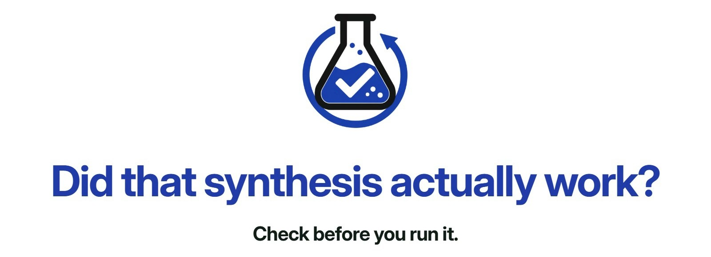

  
   
  
  
  
  

- PhD in <b>Medicinal Organic Chemistry</b> (University of Birmingham) with 4+ years in small-molecule drug discovery. 
- Visiting Scientist in the <a href="https://github.com/reymond-group">Reymond group</a>, University of Bern. 
- 🏆 1st place, <b>Boltz Challenge</b>, Boltz x AI4Science Zurich Hackathon (Oct 2026).

### ⚗️ Featured project: ChemRepro

Verified chemists rate whether published reactions actually work, attached to the paper's DOI.

<table align="center">
<tr>
  <th align="center">Project</th>
  <th align="center">Stars</th>
  <th align="center">Live</th>
  <th align="center">Technologies</th>
</tr>
<tr>
  <td align="center"><a href="https://github.com/dkovari27/ChemRepro">ChemRepro</a></td>
  <td align="center"></td>
  <td align="center"></td>
  <td align="center">
    
    
    
    
    
  </td>
</tr>
</table>

### 🧰 Toolbox

